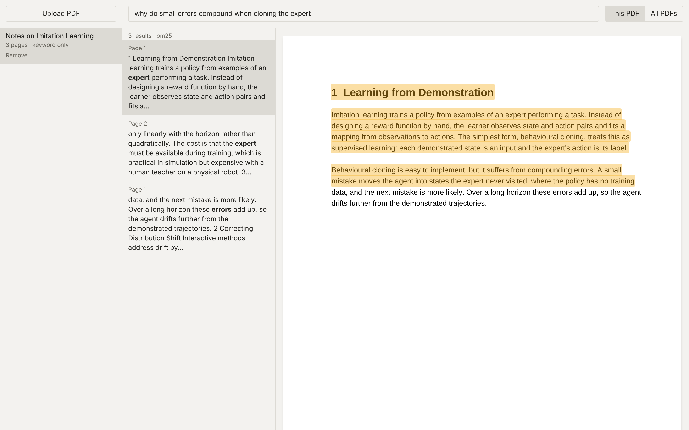

# Semantic PDF Reader

[](https://github.com/fredwang1012/semantic-pdf-reader/actions/workflows/ci.yml)

A PDF reader where you search by meaning instead of exact words. Upload a PDF, type a question, and the reader jumps
to the page that answers it and highlights the passage. Search runs inside one document or across your whole library.
Everything runs locally; nothing leaves your machine.



## Features

- **Jump to the passage.** A result opens the page and draws a highlight over the matching lines in the pdf.js view.
- **Hybrid search.** BM25 keyword scoring, plus multilingual-e5 embeddings when the `embed` extra is installed.
  Paraphrased questions and questions in another language still find the right page.
- **Library-wide search.** Results are grouped by document, with the documents that cover the most query terms first.
- **Scanned PDFs are rejected** at upload with a clear message, since there is no text layer to search.

## Quick start

Prerequisites: Python 3.12 with [uv](https://docs.astral.sh/uv/), and Node 20.19+ or 22.12+ (Vite 8 requirement).

```bash
cd backend && py -3.12 -m uv sync       # or plain: uv sync
# optional, for hybrid search (a large PyTorch download): py -3.12 -m uv sync --extra embed
# the first run then also downloads the embedding model (about 470 MB)
cd ../frontend && npm install && npm run build
cd ../backend && py -3.12 -m uv run uvicorn app.main:app --port 8000
```

Open **http://localhost:8000**. The backend serves the built frontend and the API on the same port. For hot reload,
also run `cd frontend && npm run dev` and open http://localhost:5173 (Vite proxies `/api` to port 8000; set
`READER_API` for another backend URL).

Settings come from the environment or a `.env` file at the repo root; see [.env.example](.env.example). They are
`EMBED` (`auto` or `off`), `DATA_DIR`, `MAX_UPLOAD_MB` and `CORS_ORIGINS`. `GET /api/health` reports whether search is
running as `hybrid` or `bm25`.

## How it works

1. **Extraction.** PyMuPDF reads each page's text as lines, each with its bounding box.
2. **Chunks.** Lines are grouped into chunks of about 600 characters. A chunk closes at a page break once it holds 250
   characters, so a chunk has a page to jump to.
3. **Index.** Each chunk is scored with BM25Plus, scaled by the document's highest score. In hybrid mode each chunk
   also gets a cosine similarity against the query embedding, added with weight 0.6. Without embeddings, a chunk must
   share at least one query word that is not a stopword (such as "the") to count as a hit.
4. **Highlights.** A hit carries `[page, x0, y0, x1, y1]` rectangles in PDF points. The viewer scales them by the page
   zoom and draws them over the pdf.js canvas.

Each PDF is stored in its own folder under `data/docs/`, named by the file's hash, so uploading the same file twice
reuses the existing entry. A library search ranks documents by how many query terms they cover, then by score.

```
backend/    FastAPI app (app/), tests, eval harness (eval/)
frontend/   React + Vite + pdf.js app (src/), tests
data/       uploaded PDFs and indexes (gitignored)
```

## Evaluating retrieval

`backend/app/evaluate.py` compares BM25 and hybrid retrieval on a hand-labelled question set (recall@k and MRR, with
latency percentiles). Setup and commands are in [backend/eval/README.md](backend/eval/README.md).

## Tests

```bash
cd backend  && py -3.12 -m uv run pytest -q
cd frontend && npm test && npm run typecheck
```

No test downloads a model or uses the network; embeddings are faked. GitHub Actions runs the same checks, plus lint, on every
push to `main` and every pull request.

## Limitations

- No OCR. A PDF without a text layer is rejected.
- Without the `embed` extra, search is keyword-based only.
- Scores are not calibrated across documents, so library search ranks documents by query-term coverage first.
- Rotated pages are not handled; highlights assume an unrotated page.

## Roadmap

- Run the eval on the CSC2626 Week 5 papers and publish the numbers.
- Compare against ColQwen visual retrieval.
- Add a reranker.
- Answers with citations, reusing the arXiv paper RAG project.

## License

Copyright (c) 2026 Frederick Wang. All rights reserved. See [LICENSE](LICENSE).
